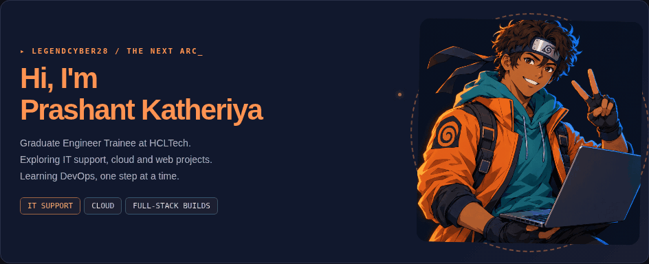
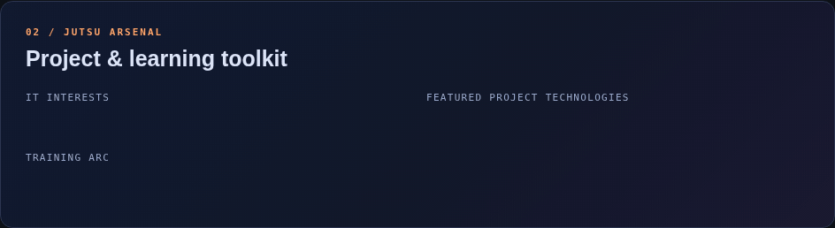
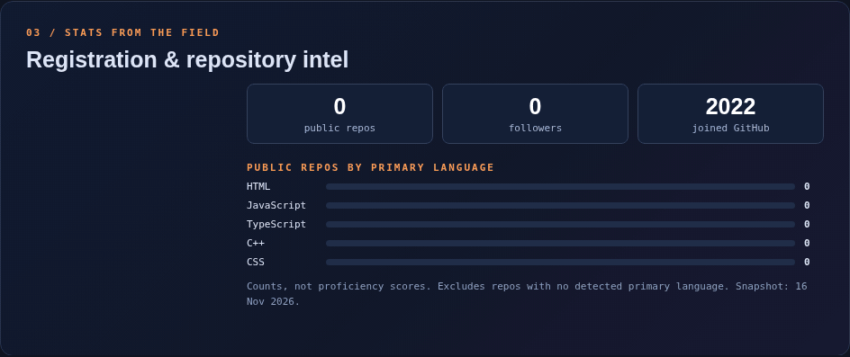
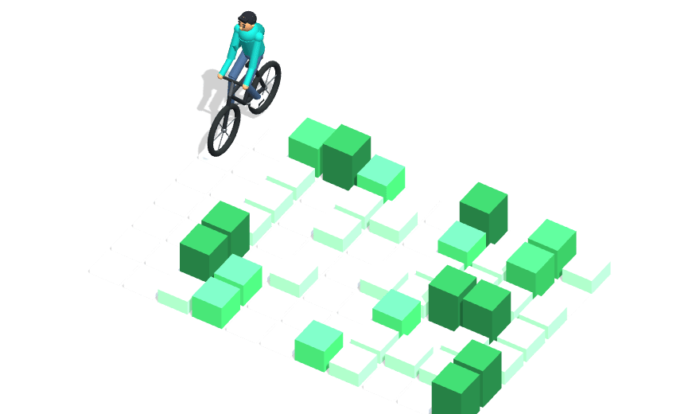

<picture>
  <source media="(max-width: 600px)" srcset="./assets/2-2-ninja-hero-mobile.gif">
  
</picture>

  

<picture>
  <source media="(max-width: 600px)" srcset="./assets/10-9-ninja-run-mobile.gif">
  
</picture>

  

<picture>
  <source media="(max-width: 600px)" srcset="./assets/4-4-ninja-way-mobile.gif">
  
</picture>

  

<picture>
  <source media="(max-width: 600px)" srcset="./assets/6-6-ninja-tools-mobile.gif">
  
</picture>

  

<picture>
  <source media="(max-width: 600px)" srcset="./assets/8-8-ninja-intel-mobile.gif">
  
</picture>

  

## S-Rank missions / Featured repositories

| Mission | What it is | Jutsu used |
| --- | --- | --- |
| [Interactive 3D Portfolio](https://github.com/legendcyber28/prashant-3d-portfolio) | Cyclist-led interactive world | React, Three.js |
| [Sweety](https://github.com/legendcyber28/sweety) | Blood glucose tracking assignment | React, Node.js, PostgreSQL |
| [Remote Interview Platform](https://github.com/legendcyber28/Remote-interview-platform) | Video calls and interview scheduling | Next.js |
| [Gemini ChatGPT Clone](https://github.com/legendcyber28/Chat-gpt) | Streaming AI chat interface | Next.js, TypeScript |
| [Coaching Fee Manager](https://github.com/legendcyber28/coaching-fee-manager-mvp) | Coaching fee management app | Web application |

## My contribution village

Still moving, one commit at a time.

## Join the squad

Let's build something useful.

[LinkedIn](https://www.linkedin.com/in/prashant-katheriya/) · [Portfolio](https://legendcyber28.github.io/prashant-3d-portfolio/) · [Instagram](https://www.instagram.com/devspace786/)

[Email](mailto:prashantkatheriya9970@gmail.com)
