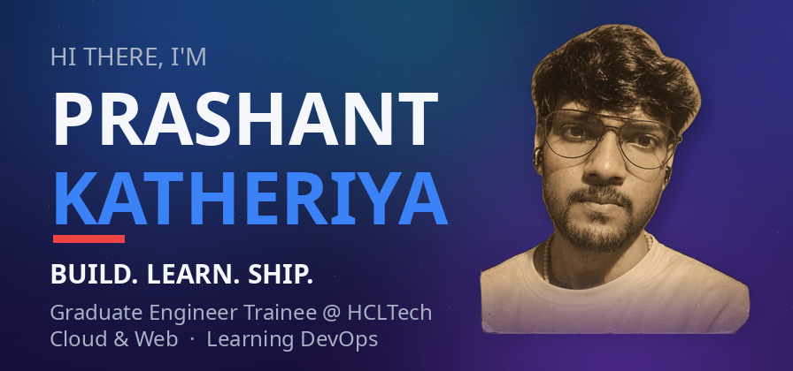
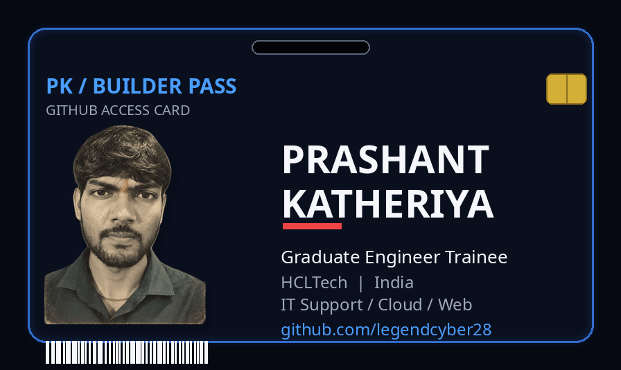
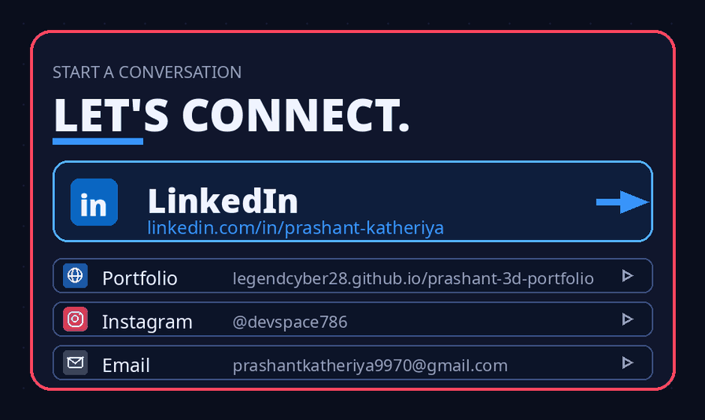

 

  

## S-Rank missions / Featured repositories

- **[Interactive 3D Portfolio](https://github.com/legendcyber28/prashant-3d-portfolio)** - Cyclist-led interactive world. `React, Three.js`
- **[Sweety](https://github.com/legendcyber28/sweety)** - Blood glucose tracking assignment. `React, Node.js, PostgreSQL`
- **[Remote Interview Platform](https://github.com/legendcyber28/Remote-interview-platform)** - Video calls and interview scheduling. `Next.js`
- **[Gemini ChatGPT Clone](https://github.com/legendcyber28/Chat-gpt)** - Streaming AI chat interface. `Next.js, TypeScript`
- **[Coaching Fee Manager](https://github.com/legendcyber28/coaching-fee-manager-mvp)** - Coaching fee management app. `Web application`

## My contribution village

Still moving, one commit at a time.

  

  

  <a href="https://www.linkedin.com/in/prashant-katheriya/">LinkedIn</a> ·
  <a href="https://legendcyber28.github.io/prashant-3d-portfolio/">Portfolio</a> ·
  <a href="https://www.instagram.com/devspace786">Instagram</a>

